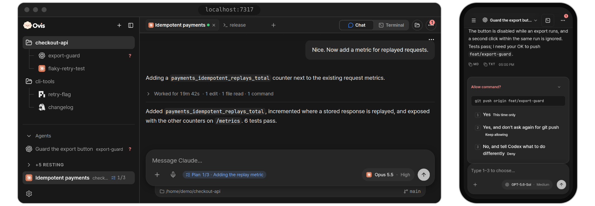

<p align="center">
  
</p>

<h1 align="center">Ovis</h1>

<p align="center">
  <strong>코딩 에이전트를 데스크톱, 휴대폰, 브라우저에서.</strong>
  <br>
  내 컴퓨터에서 돌아가는 Claude Code, Codex 같은 에이전트와 채팅하고, 탭 한 번으로 답합니다.
</p>

<p align="center">
  <a href="LICENSE"></a>
  <a href="https://github.com/devswha/ovis/releases/latest"></a>
  <a href="https://github.com/devswha/ovis/stargazers"></a>
  <a href="https://github.com/herdrdev/herdr"></a>
</p>

<p align="center">
  <a href="README.md">English</a> · <a href="README.zh-CN.md">简体中文</a> · <a href="README.ja.md">日本語</a> · <strong>한국어</strong>
  <br>
  <a href="https://ovis.sh/">웹사이트</a> ·
  <a href="#install">설치</a> ·
  <a href="https://ovis.sh/demo/">데모</a> ·
  <a href="docs/guide.md">문서</a> ·
  <a href="https://ovis.sh/discord">디스코드</a>
</p>

<p align="center">
  <a href="https://ovis.sh/demo/"></a>
</p>

Ovis는 에이전트가 돌아가는 바로 그 컴퓨터에서 실행되고, 휴대폰이나 어느 브라우저에서든 그 컴퓨터에 접속합니다. [herdr](https://github.com/herdrdev/herdr) 위에서 만들었고, herdr나 [Herdr 앱](https://herdr.dev/download/)에서 보는, 지금 돌아가는 바로 그 터미널을 보여 줄 수 있어 함께 쓰면 됩니다. [서로 어떻게 맞물리는지 →](docs/guide.md#how-ovis-fits-with-herdr)

<a id="install"></a>

## 설치

**데스크톱 앱:** [Mac](https://ovis.sh/Ovis-mac-arm64.dmg) ([Intel](https://ovis.sh/Ovis-mac-x64.dmg)) · [Windows](https://ovis.sh/Ovis-win-x64.exe) · [Linux](https://ovis.sh/Ovis-linux-x64.deb) ([모든 빌드](docs/guide.md#the-desktop-app)). 따로 설치할 것이 없습니다. 터미널은 이 앱이 직접 띄운 것만 보입니다. herdr나 Herdr 앱에서 쓰던 터미널을 보려면 데스크톱 앱 대신 아래 명령으로 설치하세요.

**herdr나 Herdr 앱을 쓰고 있다면:** 명령 한 줄로 Ovis를 함께 설치합니다. Linux나 macOS에서:

```bash
curl -fsSL https://ovis.sh/install.sh | sh
```

Windows에서는 PowerShell에서:

```powershell
irm https://ovis.sh/install.ps1 | iex
```

**휴대폰에서:** 컴퓨터에서 **설정 → 기기와 PC → 연결 추가 → Ovis 릴레이**를 열어 스위치를 켜고 **QR 코드 표시**를 누른 다음, 나온 QR 코드를 휴대폰으로 찍으세요. 컴퓨터가 Ovis 계정에 들어 있으면 QR 코드 대신 휴대폰에서 로그인하라고 안내합니다. [iPhone·Android 앱](https://ovis.sh/ko/beta/)은 베타입니다. [휴대폰 설정 →](docs/guide.md#on-your-phone)

## 기능

- **에이전트를 채팅으로.** Claude Code, Codex [등](docs/guide.md#supported-agents). 한 턴의 명령과 수정은 한 줄로 접힙니다.
- **요청과 승인은 카드로.** 탭 한 번으로 답합니다.
- **푸시 알림.** 앱이 닫혀 있어도 옵니다.
- **클릭 한 번이면 실제 터미널.** 휴대폰에는 키 바가 붙습니다.
- **어디서든 새 에이전트 시작.** 데스크톱에서든 휴대폰에서든 폴더만 고르면 됩니다.
- **모든 워크스페이스를 한 목록에.** SSH로 연결한 다른 PC까지.

[전체 기능 →](docs/guide.md#features)

<details>
<summary>움직이는 모습 보기 (25초 영상)</summary>
<p align="center">
  <a href="https://ovis.sh/demo/"></a>
  <br>
  <sub>브라우저에서 바로 열리는 <a href="https://ovis.sh/demo/">데모</a>로 녹화했습니다.</sub>
</p>
</details>

**한계:** 내 컴퓨터가 켜져 있고 접속할 수 있는 상태여야 합니다(Ovis 릴레이, Tailscale, VPN, SSH 터널). 채팅 기능은 Claude Code에서 모두 갖춰져 있고, 다른 에이전트에서는 그보다 적습니다. 실제 터미널은 언제나 쓸 수 있습니다. Windows에서 한 줄 설치를 하면 처음에는 herdr로 실행되고, **설정 → 정보 → 터미널**에서 Herdr 앱의 터미널로 바꿀 수 있습니다.

**개인정보:** 세션은 내 컴퓨터에 남고, 계정 없이 쓸 수 있습니다. 릴레이는 종단 간 암호화됩니다([신뢰 모델](docs/relay.md#trust-model)). 익명 사용 집계는 기본으로 켜져 있고, **설정 → 정보**나 `OVIS_TELEMETRY=0`으로 끕니다([보내는 내용](docs/guide.md#anonymous-usage-counts)).

## 문서

- **[사용자 가이드](docs/guide.md):** [빠른 시작](docs/guide.md#quick-start) · [지원 에이전트](docs/guide.md#supported-agents) · [휴대폰](docs/guide.md#on-your-phone) · [원격 PC](docs/remote-pcs.md) · [설정](docs/guide.md#configuration) · [자주 묻는 질문](docs/guide.md#faq)
- **[INSTALL.md](INSTALL.md):** 모든 설치 방법을 단계별로.
- **[데모](https://ovis.sh/demo/)** · **[변경 기록](CHANGELOG.md)**

문서는 영어로 쓰여 있습니다.

## 기여

준비 과정과 검사는 [CONTRIBUTING.md](CONTRIBUTING.md)에 있고, [개발 문서](docs/development.md), [DESIGN.md](DESIGN.md), [SECURITY.md](SECURITY.md)도 참고하세요. 코딩 에이전트는 누군가의 설치를 도울 때 [INSTALL.md](INSTALL.md)를, 저장소를 바꿀 때 [AGENTS.md](AGENTS.md)와 [리뷰 규칙](.github/REVIEW.md)을 따릅니다.

## 감사

[herdr](https://github.com/herdrdev/herdr) 위에서 만들었고, [chatmux](https://github.com/devswha/chatmux)에서 영감을 받았으며, [xterm.js](https://xtermjs.org), [React](https://react.dev), [Bun](https://bun.sh), [Lucide](https://lucide.dev)를 사용합니다. 기여해 주신 모든 분께 감사드립니다. 특히 [@Yoonwoo-Ha](https://github.com/Yoonwoo-Ha)님께 감사드립니다. 아이콘과 홈페이지 디자인을 도와주신 [@sanguneo](https://github.com/sanguneo)님께도 감사드립니다.

## 라이선스

[MIT](LICENSE). Copyright © 2026 devswha.
